  

<h1 align="center">Hi 👋, I'm Abhishek Jaiswal

  

  

# <h1 align="center">💫 About Me
🚀 I’m building AI-powered marketing projects, analyzing ad campaigns, experimenting with growth strategies, and creating data-driven dashboards to showcase my marketing expertise. 📊🎯 🤝 I’m looking to collaborate on AI-powered marketing, performance campaigns, growth experiments, SEO/GEO, marketing analytics, and open-source projects that drive measurable business growth. 🚀 💡 I’m looking for help with real-world marketing projects, performance marketing strategies, AI-powered growth tools, campaign optimization, and opportunities to learn, experiment, and grow. 🚀 📚 I’m currently learning AI-powered performance marketing, Google & Meta Ads, GA4, SEO/GEO, SQL, marketing analytics, conversion optimization, and automation. 🚀 💬 Ask me about performance marketing, growth strategies, AI-powered marketing, paid ads, SEO/GEO, marketing analytics, and turning clicks into customers. 🚀 😎 Fun fact: I love turning data into growth strategies—and believe the best marketing makes people stop scrolling, start caring, and take action! 🚀📈

  

  

# <h1 align="center"> 🌐 Socials
    

- 👨‍💻 All of my projects are available at [https://github.com/Abhijais4896](https://github.com/Abhijais4896)

- 📝 I regularly write articles on [https://dev.to/abhishekjaiswal_4896](https://dev.to/abhishekjaiswal_4896)

- 📫 How to reach me **abhishek.77647@gmail.com**

- 📄 Know about my experiences [https://www.linkedin.com/in/abhishekjaiswal076](https://www.linkedin.com/in/abhishekjaiswal076)
  
- 🌟 My Portfolio [https://abhishekjaiswal-pmportfolio.vercel.app/](https://abhishekjaiswal-pmportfolio.vercel.app/)

  

# <h1 align="center"> 💻 Tech Stack:
                                                             

  

<h1 align="center">💼 Marketing Work Experience</h1>

  

  
  
  

<table>
  <tr>
    <th colspan="2" align="center">🚀 PROFESSIONAL EXPERIENCE</th>
  </tr>

  <tr>
    <td width="30%" align="center" valign="top">
      
        
      <b>Product Marketing Intern</b>
       
      Product Positioning & Go-to-Market
        
      
        
      
       
      📍 Remote · Noida, India
        
      
    </td>
    <td valign="top">
      <b>🎯 Focus: Market Research · Product Positioning · Go-to-Market Strategy</b>
      <ul>
        <li>🔎 Conducted competitor research and analyzed customer needs to identify market trends, product positioning opportunities, and potential differentiators.</li>
        <li>🎯 Supported product messaging and go-to-market activities by developing value propositions, documenting feature benefits, and aligning communication with target audience needs.</li>
        <li>📣 Collaborated on product marketing materials and reviewed user feedback and engagement insights to identify opportunities to improve product adoption and customer communication.</li>
      </ul>
      <b>🧰 Skills</b>
        
      
      
      
      
      
    </td>
  </tr>

  <tr>
    <td colspan="2">
</td>
  </tr>

  <tr>
    <td width="30%" align="center" valign="top">
      
        
      <b>Digital Marketing Intern</b>
       
      SEO · Content · Social Media
        
      
        
      
       
      📍 Remote · Hyderabad, India
        
      
    </td>
    <td valign="top">
      <b>🎯 Focus: Digital Campaigns · Search Visibility · Audience Engagement</b>
      <ul>
        <li>📈 Supported digital marketing campaigns across SEO, social media, and content marketing to improve online visibility, audience engagement, and website traffic.</li>
        <li>🔍 Conducted keyword research, competitor analysis, and content optimization to strengthen search visibility and align marketing activities with audience search intent.</li>
        <li>📊 Monitored campaign performance using marketing analytics tools, tracked key metrics, and identified opportunities to improve engagement, traffic, and conversion rates.</li>
      </ul>
      <b>🧰 Skills</b>
        
      
      
      
      
      
    </td>
  </tr>

  <tr>
    <td colspan="2">
</td>
  </tr>

  <tr>
    <td width="30%" align="center" valign="top">
      
        
      <b>Marketing Data Analyst</b>
       
      Campaign Intelligence & Performance
        
      
        
      
       
      📍 Remote · Hyderabad, India
        
      
    </td>
    <td valign="top">
      <b>🎯 Focus: Campaign Analysis · Marketing KPIs · Data-Driven Optimization</b>
      <ul>
        <li>📊 Analyzed marketing campaign data, customer behavior, and engagement metrics to identify performance trends and opportunities to improve campaign effectiveness.</li>
        <li>📈 Developed and maintained marketing dashboards and reports tracking KPIs, including CTR, CPC, conversion rate, customer acquisition cost (CAC), and ROI.</li>
        <li>💡 Translated marketing data into actionable insights and optimization recommendations to support campaign planning, audience targeting, and data-driven decision-making.</li>
      </ul>
      <b>🧰 Skills</b>
        
      
      
      
      
      
    </td>
  </tr>
</table>

  
    
  <b>📊 Data-Driven Thinking · 🎯 Customer-Centric Strategy · 🚀 Measurable Growth</b>
   
  <i>Combining marketing strategy, analytics, and technology to turn insights into business growth.</i>

  

<h1 align="center">🚀 Marketing Portfolio Projects</h1>

  

  
  
  

<table>
<tr>
<td width="50%" valign="top">

### 🤖 AI-Powered Marketing Analytics & Automation

**Marketing Intelligence & Automation System**

📅 `2026` &nbsp; 🤖 `AI + Analytics`

> **Objective:** Combine marketing data, AI-assisted insights, and automation to improve reporting and campaign decision-making.

**⚡ Project Work**

* 📊 Consolidated campaign and website data into a centralized dashboard using Looker Studio, Google Sheets, or similar analytics tools.
* 🧠 Designed an AI-assisted workflow to summarize campaign performance, flag anomalies, and recommend areas for investigation.
* ⚙️ Planned automated reporting and lead follow-up workflows using suitable marketing automation tools.
* 📈 Defined measurement criteria for reporting time, lead response time, data quality, and campaign trends.

**🔑 Core Areas**

`Marketing Analytics` `AI Workflows`
`Looker Studio` `Automation` `KPI Tracking`

 

</td>

<td width="50%" valign="top">

### 🎯 E-commerce Performance Marketing Campaign

**Paid Acquisition & Conversion Optimization**

📅 `2026` &nbsp; 🛍️ `E-commerce`

> **Objective:** Design a data-driven advertising strategy to acquire customers, improve conversions, and measure campaign efficiency.

**⚡ Project Work**

* 🔎 Researched target audiences, competitors, and customer buying behavior to develop campaign messaging and ad creative concepts.
* 📣 Structured Google Ads and Meta Ads campaigns with audience targeting, budget allocation, and conversion tracking.
* 📊 Designed a performance dashboard tracking CTR, CPC, conversion rate, CPA, ROAS, and revenue.
* 🧪 Proposed optimization experiments for ad creatives, landing pages, and audience segments based on campaign performance.

**🔑 Core Areas**

`Google Ads` `Meta Ads`
`Paid Acquisition` `ROAS & CPA`
`Conversion Optimization`

 

</td>
</tr>

<tr>
<td colspan="2">
</td>
</tr>

<tr>
<td width="50%" valign="top">

### 🔍 SEO & Organic Growth Strategy

**Search Visibility & Organic Acquisition**

📅 `2026` &nbsp; 🌱 `SEO + GEO`

> **Objective:** Build a sustainable organic growth strategy across traditional search engines and AI-assisted discovery experiences.

**⚡ Project Work**

* 🔎 Conducted keyword research, search-intent analysis, competitor research, and a technical SEO audit.
* 📝 Developed a content plan targeting informational, commercial, and transactional search queries.
* 🌐 Planned page optimization for search visibility and AI-assisted discovery using clear answers, structured content, and credible sources.
* 📈 Defined tracking for impressions, clicks, organic traffic, keyword rankings, and qualified conversions.

**🔑 Core Areas**

`Technical SEO` `Keyword Research`
`Content Strategy` `GEO`
`Organic Growth` `Search Analytics`

 

</td>

<td width="50%" valign="top">

### 🚀 SaaS Product Launch & Go-to-Market Strategy

**Product Marketing & Customer Acquisition**

📅 `2026` &nbsp; 💻 `B2B / SaaS`

> **Objective:** Develop a go-to-market strategy that connects customer needs, differentiated positioning, and measurable acquisition goals.

**⚡ Project Work**

* 🎯 Defined the ideal customer profile, customer pain points, competitor positioning, and product value proposition.
* ✍️ Developed messaging, landing-page copy, launch content, and channel strategies for LinkedIn, email, and paid campaigns.
* 📊 Designed a launch funnel tracking sign-ups, activation, trial-to-paid conversion, and customer acquisition cost.
* 🧪 Prepared a go-to-market presentation and proposed experiments to validate positioning, messaging, and acquisition channels.

**🔑 Core Areas**

`Product Marketing` `GTM Strategy`
`Positioning & Messaging` `SaaS Growth`
`Funnel Analytics` `Experimentation`

 

</td>
</tr>
</table>

 

  

  <b>📊 Data-Driven Decisions · 🧪 Continuous Experimentation · 🚀 Measurable Growth</b>
    
  <i>Combining marketing strategy, AI, analytics, and experimentation to turn customer insights into business growth.</i>

  

<h1 align="center">🛡️Published Projects</h1>

<table>
<tr>
<td width="50%" align="center">

</td>

<td width="50%" align="center">

</td>
</tr>
</table>

  

<h1 align="center">📱 Certifications</h1>

  

  

  

   

  

  

  

   

  

  

  

# <h1 align="center">📊 GitHub Stats:
 
 

  

# <h1 align="center">🏆 Trophies

  

### <h1 align="center">✍️ Random Dev Quote

### <h1 align="center">🔝 Open Source Contributed Repo

  

  

  

  

